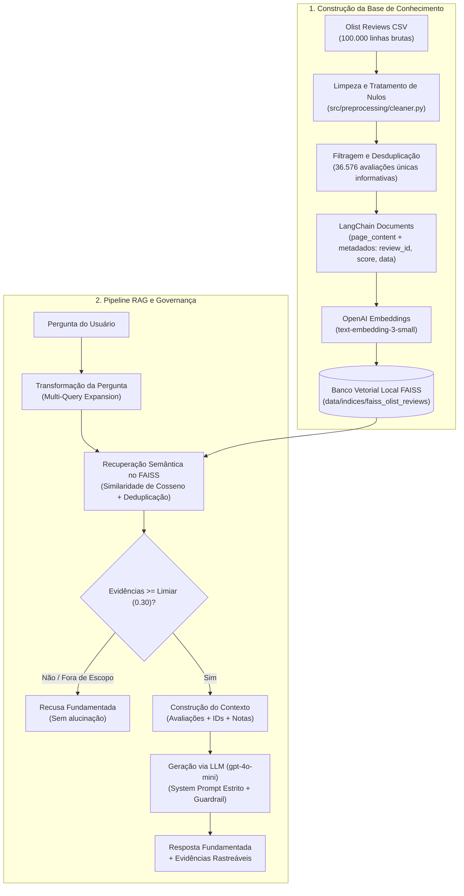

# Tech Challenge — Fase 4

**Voice of Customer Intelligence com RAG sobre a base Brazilian E-Commerce Public Dataset by Olist.**

Solução baseada em *Retrieval-Augmented Generation* (RAG) com `LangChain`, `FAISS` e `OpenAI` (`text-embedding-3-small` e `gpt-4o-mini`) para transformar as avaliações textuais não estruturadas de consumidores da Olist em uma base de conhecimento inteligente, auditável e fundamentada em evidências reais.

---

## Sumário

1. [Problema de negócio e contexto](#1-problema-de-negócio-e-contexto)
2. [Objetivo da solução](#2-objetivo-da-solução)
3. [Arquitetura desenvolvida](#3-arquitetura-desenvolvida)
4. [Preparação da base de conhecimento](#4-preparação-da-base-de-conhecimento)
5. [Estratégia utilizada para construção do pipeline RAG](#5-estratégia-utilizada-para-construção-do-pipeline-rag)
6. [Tecnologias e bibliotecas utilizadas](#6-tecnologias-e-bibliotecas-utilizadas)
7. [Justificativa das principais decisões técnicas](#7-justificativa-das-principais-decisões-técnicas)
8. [Exemplos de perguntas, respostas e evidências](#8-exemplos-de-perguntas-respostas-e-evidências)
9. [Tratamento de perguntas sem evidências suficientes](#9-tratamento-de-perguntas-sem-evidências-suficientes)
10. [Estrutura do repositório](#10-estrutura-do-repositório)
11. [Instruções para instalação, execução e reprodução](#11-instruções-para-instalação-execução-e-reprodução)
12. [Validação e testes automatizados](#12-validação-e-testes-automatizados)
13. [Documentação complementar](#13-documentação-complementar)
14. [Autoria](#14-autoria)

---

## 1. Problema de negócio e contexto

Empresas de e-commerce recebem diariamente milhares de avaliações contendo percepções, elogios, reclamações e relatos sobre diferentes etapas da jornada de compra. Embora indicadores quantitativos, como notas de avaliação (`review_score`), permitam acompanhar o nível geral de satisfação, os insights acionáveis encontram-se nos comentários textuais não estruturados:

- Quais são os principais motivos de insatisfação dos clientes?
- Quais reclamações relacionadas à entrega aparecem com maior frequência?
- O que os consumidores mais valorizam em sua experiência?
- Quais padrões podem ser identificados nas avaliações de clientes insatisfeitos?
- Quais evidências reais sustentam determinado insight executivo?

Analisar manualmente dezenas de milhares de comentários é uma tarefa lenta e pouco escalável. Esta solução utiliza **Inteligência Artificial Generativa** e **RAG** sobre a base pública da Olist (~100 mil avaliações realizadas entre 2016 e 2018) para permitir que gestores e analistas realizem perguntas em linguagem natural e obtenham respostas fundamentadas diretamente nos relatos reais dos clientes.

---

## 2. Objetivo da solução

Implementar uma arquitetura ponta a ponta de **Retrieval-Augmented Generation (RAG)** capaz de:

1. Processar, higienizar e indexar vetorialmente os comentários reais da base `olist_order_reviews_dataset.csv`;
2. Transformar a pergunta do usuário e recuperar semanticamente as avaliações mais relevantes;
3. Construir um contexto estruturado e rastreável para o modelo de linguagem;
4. Gerar respostas analíticas fundamentadas exclusivamente nas evidências recuperadas, citando o `review_id` e a nota (`review_score`) de cada relato utilizado;
5. Reconhecer limitações de escopo e recusar a geração de informações sem suporte nos dados quando não existirem evidências suficientes.

---

## 3. Arquitetura desenvolvida

O fluxo completo divide-se em duas etapas principais: **Construção da Base de Conhecimento** e **Pipeline RAG de Consulta e Governança**.



Detalhamento completo em [docs/arquitetura.md](docs/arquitetura.md).

---

## 4. Preparação da base de conhecimento

A base original `olist_order_reviews_dataset.csv` ([data/raw/olist_order_reviews_dataset.csv](data/raw/olist_order_reviews_dataset.csv)) contém `100.000` registros. O módulo [src/preprocessing/loader.py](src/preprocessing/loader.py) executa o funil de qualidade auditado em [reports/data-cleaning-audit.json](reports/data-cleaning-audit.json):

| Etapa de Preparação | Registros | Estratégia Aplicada |
| :--- | ---: | :--- |
| **1. Seleção dos dados** | `100.000` | Recorte de `review_id`, `order_id`, `review_score`, `review_comment_title`, `review_comment_message` e `review_creation_date`. |
| **2. Tratamento de valores ausentes** | `43.463` | Consolidação complementar entre título e mensagem (`combine_title_and_message`). Descarte dos `56.518` registros onde ambos são nulos e `19` registros apenas com espaços. |
| **3. Limpeza e filtragem de ruído** | `40.017` | Normalização Unicode (`NFC`), remoção de caracteres de controle e colapso de espaços/pontuação excessiva. Remoção de `3.446` comentários não informativos (< 8 caracteres ou < 2 tokens alfanuméricos, ex.: *"ok"*, *"bom"*). |
| **4. Desduplicação textual** | **`36.576`** | Remoção de `3.441` mensagens duplicadas idênticas (*case-insensitive*) para preservar a diversidade no *top-k* da busca vetorial. |

### Distribuição das `36.576` avaliações indexáveis por nota (`review_score`)

| Nota | Quantidade | Proporção | Perfil dos Relatos |
| :---: | ---: | ---: | :--- |
| **1** | `8.739` | `23,89%` | Reclamações críticas de atraso, extravio, avaria, produto divergente e falta de estorno |
| **2** | `2.118` | `5,79%` | Insatisfação com demora de frete, entrega parcial e qualidade abaixo do esperado |
| **3** | `3.336` | `9,12%` | Avaliações neutras (produto atende, porém com ressalvas logísticas ou de acabamento) |
| **4** | `5.092` | `13,92%` | Experiências positivas com observações pontuais |
| **5** | `17.291` | `47,27%` | Elogios à entrega antes do prazo estipulado, qualidade do material e atendimento |

### Organização dos documentos, criação de embeddings e indexação

- **Organização dos documentos:** Cada avaliação tratada é instanciada como um objeto `Document` do LangChain contendo o texto consolidado em `page_content` e os metadados `review_id`, `order_id`, `review_score` e `review_creation_date`.
- **Criação dos embeddings:** Vetorização densa em 1536 dimensões via `OpenAIEmbeddings` (`text-embedding-3-small`) em [src/indexing/embeddings.py](src/indexing/embeddings.py).
- **Armazenamento e indexação:** Persistência local em disco no banco vetorial `FAISS` (`normalize_L2=True`) em [src/indexing/vector_store.py](src/indexing/vector_store.py).

---

## 5. Estratégia utilizada para construção do pipeline RAG

O pipeline RAG implementado em [src/rag/](src/rag/) contempla cinco estágios sequenciais:

1. **Transformação da pergunta ([src/rag/query_transform.py](src/rag/query_transform.py)):**
   - Utiliza uma chain LCEL (`MULTI_QUERY_PROMPT | llm | StrOutputParser()`) para expandir a pergunta original do usuário em 3 variações semânticas adaptadas ao vocabulário real de avaliações de clientes, elevando o *recall* semântico.
2. **Recuperação semântica das avaliações ([src/rag/retriever.py](src/rag/retriever.py)):**
   - Executa busca vetorial no `FAISS` para a pergunta original e suas variações, convertendo a distância euclidiana quadrática de vetores L2-normalizados em similaridade de cosseno no intervalo $[0, 1]$ ($s = 1 - d^2 / 2$).
3. **Seleção dos conteúdos mais relevantes ([src/rag/retriever.py](src/rag/retriever.py)):**
   - Desduplica os documentos recuperados por `review_id` (mantendo o maior score de similaridade obtido entre as consultas), descarta documentos abaixo do limiar de relevância (`RAG_RELEVANCE_THRESHOLD = 0.30`) e ordena de forma decrescente selecionando os `top_k = 5` relatos mais pertinentes.
4. **Construção do contexto ([src/rag/pipeline.py](src/rag/pipeline.py)):**
   - Formata cada avaliação selecionada em blocos numerados contendo `review_id`, `Nota (1 a 5)`, `Data`, `Similaridade` e o comentário literal do cliente (`format_context_block`).
5. **Geração da resposta final fundamentada ([src/rag/pipeline.py](src/rag/pipeline.py)):**
   - Envia o contexto estruturado ao modelo `gpt-4o-mini` (`temperature=0.0`) sob instrução estrita de responder **exclusivamente** com base nas evidências fornecidas e citar `[review_id: <id>, Nota: <nota>/5]` em cada insight apresentado.

---

## 6. Tecnologias e bibliotecas utilizadas

| Categoria | Tecnologia / Biblioteca | Versão | Papel na Solução |
| :--- | :--- | :--- | :--- |
| **Linguagem & Ambiente** | Python + `.venv` | `3.12+` | Execução isolada dentro do diretório do projeto |
| **Orquestração LLM / RAG** | `langchain` & `langchain-core` | `>=1.4,<2.0` | Construção das chains LCEL, prompts e abstração de documentos |
| **Provedor de IA Generativa** | `langchain-openai` (`openai`) | `>=1.6,<2.0` | Embeddings (`text-embedding-3-small`) e Chat LLM (`gpt-4o-mini`) |
| **Banco de Dados Vetorial** | `faiss-cpu` & `langchain-community` | `>=1.9` | Indexação vetorial de alta performance e busca por similaridade |
| **Processamento de Dados** | `pandas` | `>=2.2.0` | Ingestão, limpeza, auditoria e manipulação tabular |
| **Configuração & Validação** | `python-dotenv` & `pydantic` | `>=1.2` / `>=2.10` | Gestão de variáveis de ambiente e validação de contratos |
| **Testes Automatizados** | `pytest` | `>=8.0.0` | Testes unitários e de integração do pipeline |

---

## 7. Justificativa das principais decisões técnicas

- **Documento inteiro por avaliação (sem *chunking* intra-comentário):** As avaliações da Olist são textos curtos (média < 200 caracteres). Fragmentar um relato curto separaria o contexto da queixa (ex.: elogio à rapidez da compra na primeira frase vs. relato de defeito na segunda frase). Manter 1 avaliação = 1 `Document` preserva a integridade semântica e garante rastreabilidade 1:1 com o `review_id`.
- **Desduplicação + filtro de informatividade mínima:** Mais de 6 mil registros na base bruta são comentários repetidos de uma única palavra (*"bom"*, *"ok"*, *"recomendo"*). Filtrar textos com menos de 8 caracteres/2 tokens e desduplicar mensagens idênticas impede que o *top-k* seja dominado por textos genéricos sem valor analítico.
- **Expansão *Multi-Query* antes da busca vetorial:** Perguntas executivas usam termos abstratos (*"problemas recorrentes"*, *"insatisfação"*), enquanto consumidores descrevem fatos específicos (*"não chegou"*, *"veio quebrado"*, *"faltou peça"*). A geração de variações semânticas aproxima a pergunta do espaço vetorial dos comentários.
- **`FAISS` local + `OpenAI` API:** Combina indexação vetorial local ultrarrápida e persistida em arquivo com modelos de estado da arte em português, sem exigir GPUs locais ou downloads de dezenas de gigabytes de pesos no sistema operacional.

Documentação detalhada das decisões em [docs/decisoes-tecnicas.md](docs/decisoes-tecnicas.md).

---

## 8. Exemplos de perguntas, respostas e evidências

Abaixo estão exemplos reais gerados pelo pipeline e auditados em [reports/rag-evaluation-examples.json](reports/rag-evaluation-examples.json) (catálogo completo em [docs/exemplos-exploracao.md](docs/exemplos-exploracao.md)):

### Exemplo 1 — Reclamações relacionadas à entrega
- **Pergunta:** *Quais reclamações relacionadas à entrega aparecem com maior frequência?*
- **Consultas Expandidas (*Multi-Query*):**
  - `Quais são as reclamações mais comuns sobre entregas?`
  - `Quais tipos de reclamações sobre entrega são mais frequentes?`
  - `Quais reclamações sobre entrega ocorrem com mais regularidade?`
- **Evidências Recuperadas (Amostra):**
  - `[review_id: 72926e5236768ffc912764ca429d0e00 | Nota: 1/5 | Relevância: 0.699]`: *"Muita demora na entrega"*
  - `[review_id: 949eca021ed60d00a2d2bda3cc686d4d | Nota: 1/5 | Relevância: 0.654]`: *"muitos desencontros nas entregas de produtos"*
  - `[review_id: 7528a396f7625967f05cb09946286608 | Nota: 1/5 | Relevância: 0.648]`: *"Ultimamente estão atrasando muito as entregas"*
  - `[review_id: f242ce44c6572a94907a446b8fda32c8 | Nota: 1/5 | Relevância: 0.638]`: *"Olá! Minha queixa é a não entrega na residência. Tive que buscar no correio. Tenho um produto que foi devolvido, e ainda nem sei o que fazer. Talvez um telefonema ajudasse."*
- **Resposta Fundamentada:**
  > As reclamações relacionadas à entrega que aparecem com maior frequência nas avaliações são:
  > 1. **Demora na entrega:** Vários clientes mencionaram a lentidão no processo de entrega, como *"muita demora na entrega"* `[review_id: 72926e5236768ffc912764ca429d0e00, Nota: 1/5]` e *"ultimamente estão atrasando muito as entregas"* `[review_id: 7528a396f7625967f05cb09946286608, Nota: 1/5]`.
  > 2. **Desencontros nas entregas:** Problemas de comunicação e organização nas entregas em *"muitos desencontros nas entregas de produtos"* `[review_id: 949eca021ed60d00a2d2bda3cc686d4d, Nota: 1/5]`.
  > 3. **Não entrega no endereço:** Clientes que não receberam o produto em sua residência e precisaram buscá-lo na agência dos Correios `[review_id: f242ce44c6572a94907a446b8fda32c8, Nota: 1/5]`.

### Exemplo 2 — Busca por experiências positivas
- **Pergunta:** *O que os clientes mais elogiam em suas experiências de compra?*
- **Evidências Recuperadas (Amostra):**
  - `[review_id: 382d855ffdd4f5e66594dbfb1566e96f | Nota: 5/5 | Relevância: 0.642]`: *"10. Cada vez que compro mais fico satisfeita parabéns pela honestidade com seus clientes 👏👏👏👏?"*
  - `[review_id: d7571a8910cfc6319c8acbba887fd33b | Nota: 5/5 | Relevância: 0.622]`: *"Nota 10. Comprometimento e dedicação com o cliente.por isso indico pra quem está com alguma dúvida referente a loja;e sobre o produto atingiu perfeitamente as minhas perspectivas."*
  - `[review_id: f8bc084927f01cb84fce083eb9aa5819 | Nota: 5/5 | Relevância: 0.611]`: *"otimo. Produtos entregues no prazo , corretamente. Certamente comprarei mais vezes."*
  - `[review_id: a644c23f94b9da0ca04ae1de4538e42a | Nota: 5/5 | Relevância: 0.603]`: *"Nota 10. Gosto muito de comprar online pela lojas lannister sempre com um atendimento excelente nota 10.saudações."*
- **Resposta Fundamentada:**
  > Os clientes elogiam principalmente: (1) **Honestidade e satisfação recorrente** `[review_id: 382d855ffdd4f5e66594dbfb1566e96f, Nota: 5/5]`; (2) **Comprometimento com o cliente e aderência às expectativas** `[review_id: d7571a8910cfc6319c8acbba887fd33b, Nota: 5/5]`; (3) **Pontualidade na entrega** `[review_id: f8bc084927f01cb84fce083eb9aa5819, Nota: 5/5]`; e (4) **Atendimento excelente** `[review_id: a644c23f94b9da0ca04ae1de4538e42a, Nota: 5/5]`.

---

## 9. Tratamento de perguntas sem evidências suficientes

Para evitar alucinações quando não existirem avaliações relevantes ou quando a pergunta estiver fora do escopo da base de conhecimento, o sistema opera com **dupla barreira de segurança** ([src/rag/pipeline.py](src/rag/pipeline.py)):

1. **Barreira 1 — *Retrieval Gate* (Pré-LLM):**
   - Todas as avaliações recuperadas têm sua similaridade de cosseno comparada com `RAG_RELEVANCE_THRESHOLD` (`0.30`). Se nenhum documento atingir o limiar mínimo, o pipeline interrompe a execução antes de chamar o LLM gerador e devolve `has_sufficient_evidence = False` (`refusal_reason = "below_relevance_threshold"`).
2. **Barreira 2 — *Guardrail de Prompt* (Pós-LLM):**
   - Se uma pergunta fora de escopo recuperar documentos por coincidência superficial de palavras, o *system prompt* instrui o LLM a validar se os comentários realmente respondem à pergunta; caso contrário, o modelo emite o marcador `SEM_EVIDENCIAS_SUFICIENTES`, acionando `has_sufficient_evidence = False` (`refusal_reason = "llm_insufficient_context_guardrail"`).

**Exemplo testado de pergunta fora do escopo:**
- **Pergunta:** *Qual é a cotação atual do dólar e a previsão do tempo em Tóquio amanhã?*
- **Evidências acima do limiar:** `0`
- **Resposta do sistema:**
  > *"Com base nas avaliações disponíveis na base de conhecimento da Olist, não foram encontradas evidências suficientes para responder a esta pergunta com segurança. A questão pode estar fora do escopo dos relatos de clientes ou não possuir ocorrências relevantes registradas."*

---

## 10. Estrutura do repositório

```text
.
├── data/
│   ├── raw/olist_order_reviews_dataset.csv     # Base original da Olist (100.000 avaliações)
│   ├── processed/olist_reviews_cleaned.csv     # Base higienizada e desduplicada (36.576 avaliações)
│   └── indices/                                # Diretório do índice vetorial FAISS persistido
├── docs/
│   ├── arquitetura.md                          # Fluxo arquitetural e responsabilidades dos módulos
│   ├── decisoes-tecnicas.md                    # Justificativas técnicas detalhadas
│   ├── dicionario-dados.md                     # Schema da base, metadados e funil de limpeza
│   ├── exemplos-exploracao.md                  # Catálogo completo de perguntas, respostas e evidências
│   └── git-workflow.md                         # Padrão de versionamento em commits atômicos
├── notebooks/
│   ├── 01_preparacao_base_conhecimento.ipynb   # EDA, limpeza, auditoria e indexação FAISS
│   └── 02_pipeline_rag_exploracao_voc.ipynb    # Demonstração do pipeline RAG, citações e recusa
├── reports/
│   ├── data-cleaning-audit.json                # Métricas auditadas do funil de preparação da base
│   └── rag-evaluation-examples.json            # Saídas estruturadas das consultas de negócio e recusa
├── src/
│   ├── config.py                               # Configurações, caminhos e limiares de governança
│   ├── cli.py                                  # Interface de linha de comando (ingest, query, evaluate)
│   ├── preprocessing/                          # Limpeza textual, tratamento de nulos e criação de Documents
│   ├── indexing/                               # Geração de embeddings OpenAI e persistência FAISS
│   └── rag/                                    # Transformação Multi-Query, busca semântica e geração fundamentada
├── tests/                                      # Suíte automatizada de testes unitários e de contrato
├── .env.example                                # Template de variáveis de ambiente
├── .gitignore                                  # Regras de exclusão do Git (.venv, .env, caches)
├── pytest.ini                                  # Configuração do Pytest
├── requirements.txt                            # Dependências do projeto
└── README.md                                   # Documentação principal
```

---

## 11. Instruções para instalação, execução e reprodução

### 11.1. Criar e ativar o ambiente virtual isolado (`.venv`)

Todo o projeto roda de forma isolada dentro da própria pasta, sem instalar pacotes no Python global da máquina:

```powershell
# Na raiz do repositório IAST-Tech-Challenge-Fase-4
python -m venv .venv

# Ativar no Windows (PowerShell)
.venv\Scripts\Activate.ps1

# Instalar as dependências dentro do .venv
.venv\Scripts\pip install -r requirements.txt
```

### 11.2. Configurar a variável de ambiente (`OPENAI_API_KEY`)

Copie o arquivo `.env.example` para `.env` e insira sua chave da OpenAI:

```powershell
Copy-Item .env.example .env
# Edite o arquivo .env definindo OPENAI_API_KEY="sk-..."
```

### 11.3. Construir a base de conhecimento e o índice vetorial FAISS

A base bruta (`data/raw/olist_order_reviews_dataset.csv`) e a base limpa (`data/processed/olist_reviews_cleaned.csv`) já acompanham o repositório. Para executar a higienização e criar o índice vetorial local em `data/indices/faiss_olist_reviews`:

```powershell
# Indexar amostra rápida (ex.: 2.000 avaliações para teste rápido)
.venv\Scripts\python -m src.cli ingest --sample-size 2000

# Ou indexar toda a base limpa (36.576 avaliações)
.venv\Scripts\python -m src.cli ingest
```

### 11.4. Realizar perguntas ao sistema RAG via CLI

```powershell
# Pergunta de negócio fundamentada em evidências
.venv\Scripts\python -m src.cli query -q "Quais reclamações relacionadas à entrega aparecem com maior frequência?"

# Teste de pergunta fora de escopo (acionamento da trava de recusa)
.venv\Scripts\python -m src.cli query -q "Qual é a cotação atual do dólar e a previsão do tempo em Tóquio amanhã?"

# Executar toda a bateria oficial de perguntas do desafio
.venv\Scripts\python -m src.cli evaluate
```

---

## 12. Validação e testes automatizados

A suíte de testes valida a limpeza de textos, tratamento de valores ausentes, desduplicação, indexação e persistência no `FAISS`, filtragem por limiar de relevância, geração fundamentada com citações e recusa determinística para perguntas sem evidências (sem exigir chamadas pagas de rede durante os testes):

```powershell
.venv\Scripts\pytest
```

---

## 13. Documentação complementar

| Documento | Conteúdo |
| :--- | :--- |
| [Arquitetura da solução](docs/arquitetura.md) | Diagrama do fluxo de ingestão e consulta RAG e responsabilidades por módulo |
| [Decisões técnicas](docs/decisoes-tecnicas.md) | Justificativas de engenharia para limpeza, documentos, embeddings, FAISS e governança |
| [Dicionário de dados](docs/dicionario-dados.md) | Schema da base Olist, contrato de metadados e funil de limpeza |
| [Exemplos de exploração](docs/exemplos-exploracao.md) | Perguntas de negócio, consultas expandidas, evidências recuperadas e respostas |
| [Auditoria de limpeza](reports/data-cleaning-audit.json) | Métricas exatas do processamento das 100.000 avaliações da Olist |
| [Relatório de avaliação RAG](reports/rag-evaluation-examples.json) | Saídas estruturadas em JSON das 5 explorações de negócio e do teste de recusa |
| [Git workflow](docs/git-workflow.md) | Padrão de commits atômicos em `main` |

---

## 14. Autoria

| Papel | Nome |
| :--- | :--- |
| **Autoria** | Jonathan Santiago Relva |

**Pós-Tech FIAP — Inteligência Artificial (Fase 4)**
