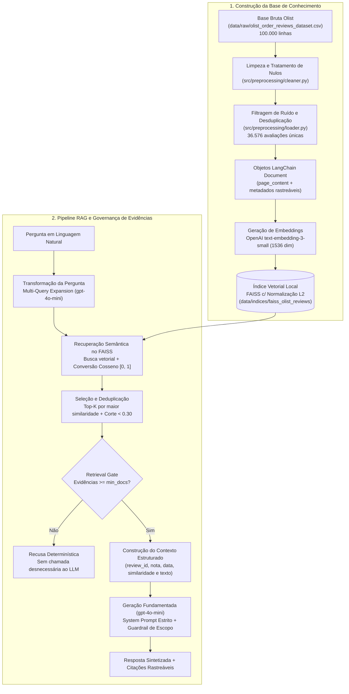

# Arquitetura da Solução — Voice of Customer Intelligence com RAG

A arquitetura foi projetada em dois fluxos desacoplados: **Construção da Base de Conhecimento (Offline/Batch)** e **Pipeline RAG de Consulta e Governança (Online)**.

---

## 1. Visão Geral do Fluxo

---

## 2. Camadas e Responsabilidades

| Camada | Módulo | Responsabilidade Técnica |
| :--- | :--- | :--- |
| **Configuração** | `src/config.py` | Centraliza caminhos de arquivos, nomes de modelos (`text-embedding-3-small`, `gpt-4o-mini`), *top-k*, *relevance threshold* (`0.30`) e mensagens padronizadas de recusa. |
| **Pré-processamento** | `src/preprocessing/cleaner.py` | Normalização Unicode (`NFC`), remoção de caracteres de controle, consolidação entre título e comentário e filtro de informatividade mínima. |
| **Carga e Auditoria** | `src/preprocessing/loader.py` | Filtra registros vazios, remove duplicatas textuais, gera auditoria em `reports/data-cleaning-audit.json` e instancia objetos `Document`. |
| **Indexação Vetorial** | `src/indexing/embeddings.py` e `vector_store.py` | Conecta à API de embeddings da OpenAI e persiste o índice vetorial `FAISS` normalizado em disco. |
| **Transformação de Consulta** | `src/rag/query_transform.py` | Expande a pergunta original em múltiplas variações semânticas usando *LangChain Expression Language* (LCEL). |
| **Recuperação Semântica** | `src/rag/retriever.py` | Executa busca vetorial para todas as variações, converte distância L2 quadrática em similaridade de cosseno, deduplica por `review_id` e aplica corte por limiar. |
| **Geração e Governança** | `src/rag/pipeline.py` | Monta o contexto rastreável, aplica o *Retrieval Gate* pré-LLM e o *Guardrail* pós-LLM para garantir respostas 100% ancoradas nas avaliações. |
| **Interface CLI** | `src/cli.py` | Permite reproduzir via linha de comando a ingestão (`ingest`), consultas livres (`query`) e a bateria oficial de avaliação (`evaluate`). |
